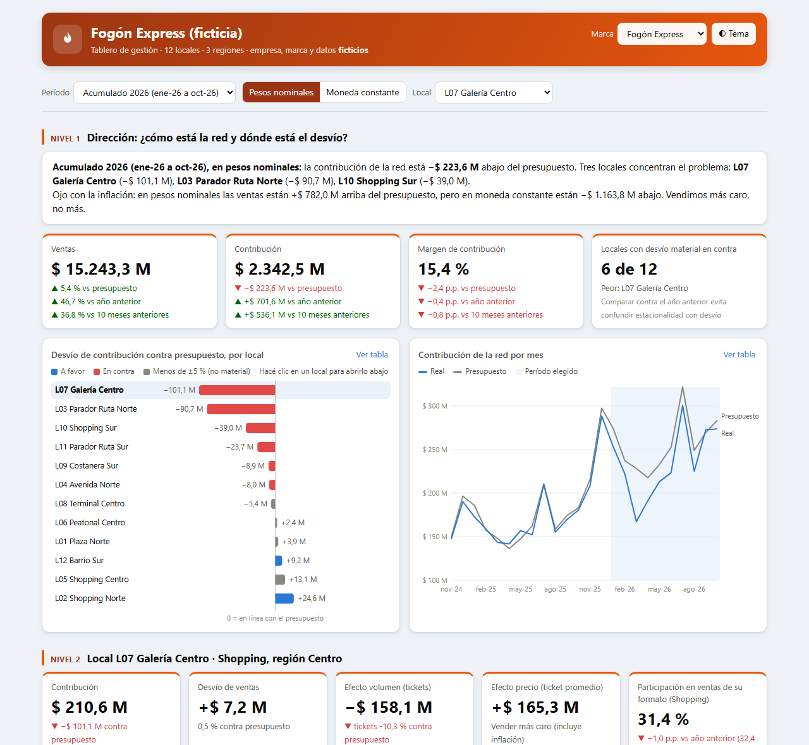
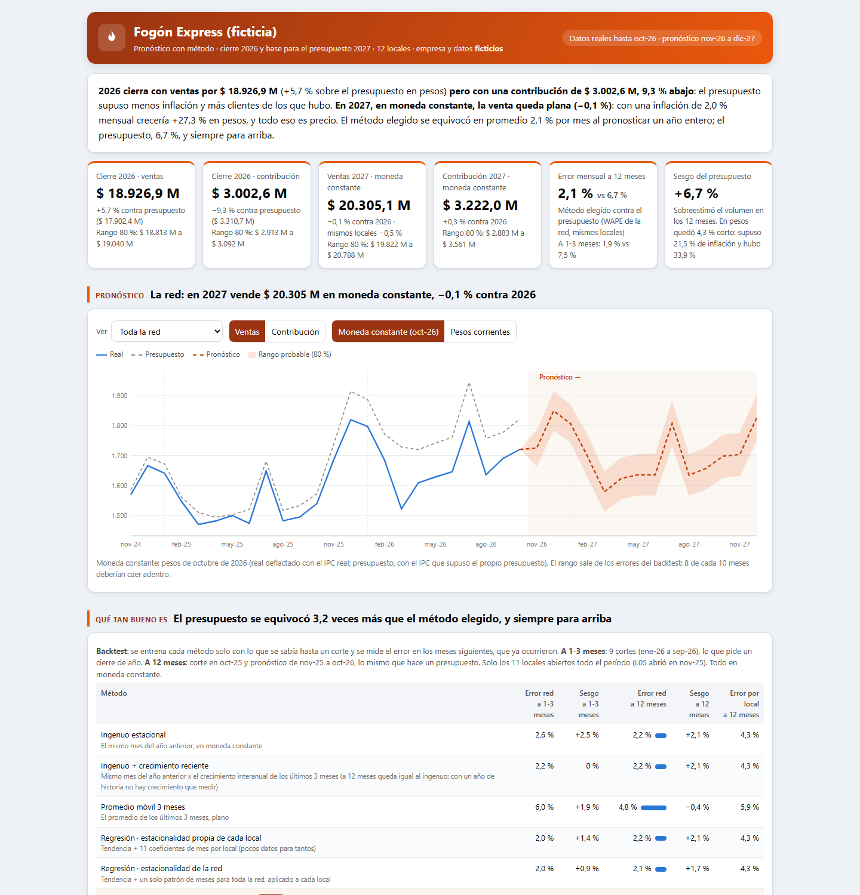
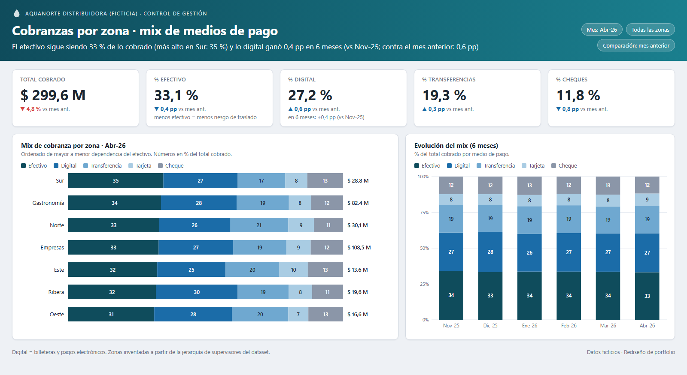

# Portfolio de control de gestión · Matías Garnica

Contador (UBA) y analista de control de gestión. Trabajo donde se cruzan los números y el negocio: **de dónde sale cada dato, cómo se calcula y cómo se le cuenta a cada gerente para que decida.**

Todo lo que hay acá usa **datos ficticios** generados con scripts incluidos en el repositorio. Se puede reproducir de punta a punta.

> 🇬🇧 [Read in English](README.md)

---

## Casos

### Cadena con 12 locales · del desvío de la red a la causa en tres clics



La dirección ve el desvío de contribución contra el presupuesto, el ranking de locales y, con un clic, el puente del desvío de cada local y su causa (nómina, operación, incidentes). Incluye:
- **Moneda nominal o constante:** en pesos se vendió más que lo presupuestado; en moneda constante, menos. Es la trampa de la inflación.
- **Comparación contra pares** ("mismos locales"), con un **umbral de materialidad** para no llenar todo de rojo.
- **Demo con login por rol:** cada usuario de prueba ve solo lo suyo. El filtro lo hace la base (seguridad por fila en Supabase), no la página.
- **El responsable explica el desvío:** causa, si era controlable, acción y plazo, al lado del número.
- **Propuesta económica** según el tamaño de la empresa: qué herramientas, cuánto cuesta y quién lo hace.

▶ [Ver el tablero](https://matiasgarnica.github.io/portfolio-control-de-gestion/casos/05_cadena-multisucursal/03_tableros/tablero_direccion.html) · ▶ [Ver la demo con login](https://matiasgarnica.github.io/portfolio-control-de-gestion/casos/05_cadena-multisucursal/03_tableros/demo_login.html) · [Documentación del caso](casos/05_cadena-multisucursal/)

### Pronóstico con método · ¿qué tan bueno es el forecast?



El cierre 2026 y la base del presupuesto 2027 de la misma cadena. Antes de elegir un método, lo prueba contra el pasado:
- **Backtest:** el método elegido se equivoca 2,1 % por mes al pronosticar un año entero. El presupuesto se equivocó 6,7 %, y siempre para arriba.
- **Precio contra volumen:** en moneda constante, 2027 queda plano. Todo el crecimiento en pesos es inflación, y se muestra con tres escenarios.
- **¿Ruido o señal?:** bandas de control por local. Con la regla fija del ±5 % había que explicar casi todo; con las bandas aparecen los tres problemas reales.

▶ [Ver el tablero](https://matiasgarnica.github.io/portfolio-control-de-gestion/casos/06_pronostico-con-metodo/03_tableros/pronostico.html) · [Método y criterios](casos/06_pronostico-con-metodo/07_docs/metodo_y_criterios.md)

### Voz de primera línea · ¿cae el mercado o cae la gestión?

Un formulario de un minuto para repartidores y atención al cliente, con categorías fijas, cruzado con las ventas por ruta. Separa la caída que viene del mercado (todas las rutas reportan "situación económica") de la que es propia de una ruta (una sola reporta "competencia"). Incluye un Apps Script que arma el resumen y la alerta de cada lunes.

▶ [Ver el tablero](https://matiasgarnica.github.io/portfolio-control-de-gestion/casos/02_voz-de-primera-linea/03_tableros/voz_primera_linea.html) · [Documentación del caso](casos/02_voz-de-primera-linea/)

### BI de una distribuidora de agua y soda · SQL + Power BI

Consultas T-SQL que reemplazaron reportes manuales y once tableros rediseñados sobre un dataset sintético de 21 tablas: clientes, rutas, pedidos, cobranzas y equipos de frío/calor.



| # | Módulo | Consulta estrella | Técnicas |
|---|---|---|---|
| 01 | [Adquisición](sql/01_acquisition/) | `altas_digital_rto.sql` | `ROW_NUMBER`, `UNION ALL` de 4 bloques, clasificación de promos |
| 02 | [Retención](sql/02_retention/) | `frio_calor_sin_consumo_60.sql` | Máquina de estados, `STUFF` + `FOR XML PATH`, priorización |
| 03 | [Equipos F/C](sql/03_fc_equipment/) | `consumo_litros_por_cliente_fc.sql` | Vigencia temporal, ratios derivados |
| 04 | [Riesgo financiero](sql/04_financial_risk/) | `deuda_gastro_por_ruta.sql` | `UNION ALL` multifuente, separación contable |
| 05 | [Segmentación](sql/05_segmentation/) | `clientes_barrios_cerrados.sql` | Coincidencia de patrones, filtrado temprano |
| 06 | [Performance comercial](sql/06_sales_performance/) | `venta_mensual_por_comercial.sql` | SQL dinámico, doble `PIVOT`, tablas temporales con índices |
| 07 | [Cobranzas](sql/07_collections/) | `cobranzas_mensuales_por_ruta.sql` | `OUTER APPLY`, parsing con `REVERSE` + `PATINDEX` |
| 08 | [Operación diaria](sql/08_daily_operations/) | `feriados_venta_a_recuperar.sql` | Alineación por día de la semana, KPI consolidado |

Los tableros son **rediseños con datos ficticios** (generados con Python a partir del dataset sintético), con el tema de colores para replicarlos en Power BI. Detalle en [`powerbi/`](powerbi/).

---

## Cómo trabajo

1. **Primero la pregunta:** qué decide quien mira el tablero.
2. **De dónde sale el dato:** cada indicador tiene su fórmula, su fuente y sus variantes documentadas, por ejemplo en el [diccionario del Caso 05](casos/05_cadena-multisucursal/07_docs/diccionario_datos_e_indicadores.md).
3. **Un número por decisión,** con contra qué se compara (presupuesto, año anterior o pares) y quién es el responsable.
4. **Seguridad desde el diseño:** quién ve qué y con qué límites.

## Reproducir

```bash
git clone https://github.com/MatiasGarnica/portfolio-control-de-gestion.git
cd portfolio-control-de-gestion
pip install pandas numpy faker
python casos/05_cadena-multisucursal/02_codigo/generar_datos.py      # datos del Caso 05
python casos/05_cadena-multisucursal/02_codigo/validar_datos.py      # controles de integridad
python data/generate_synthetic_data.py                               # dataset de la distribuidora
```

## Cómo está hecho

- **Lo mío:** la pregunta de negocio, el modelo de datos, los indicadores y sus criterios (umbral, moneda constante, comparación contra pares), el diseño de cada tablero y la validación de cada número.
- **Con asistencia de IA:** el código de apoyo (Python, JavaScript, Apps Script) se escribió con IA a partir de esas reglas. Cada caso trae un script de controles (`validar_datos.py`) que verifica que los números cierren.
- **Datos:** todos ficticios, con situaciones plantadas para que el análisis tenga algo que encontrar. Ninguna cifra viene de una empresa real.

## Contacto

**Matías Garnica** · [LinkedIn](https://www.linkedin.com/in/garnicamatias) · garnicamatias@outlook.es

Licencia [MIT](LICENSE).
