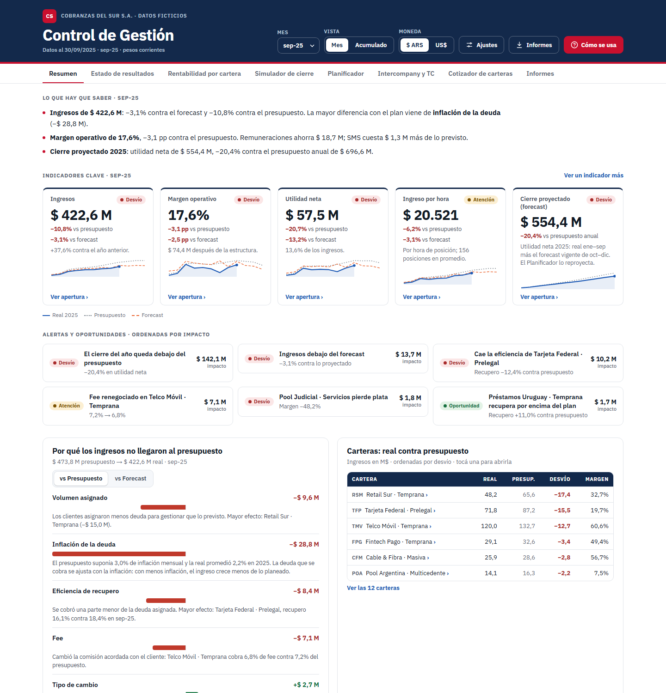
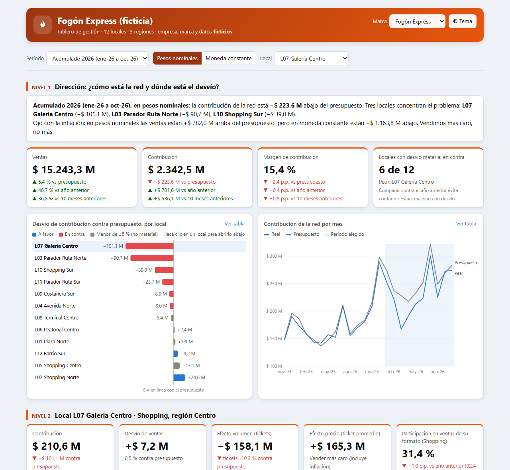
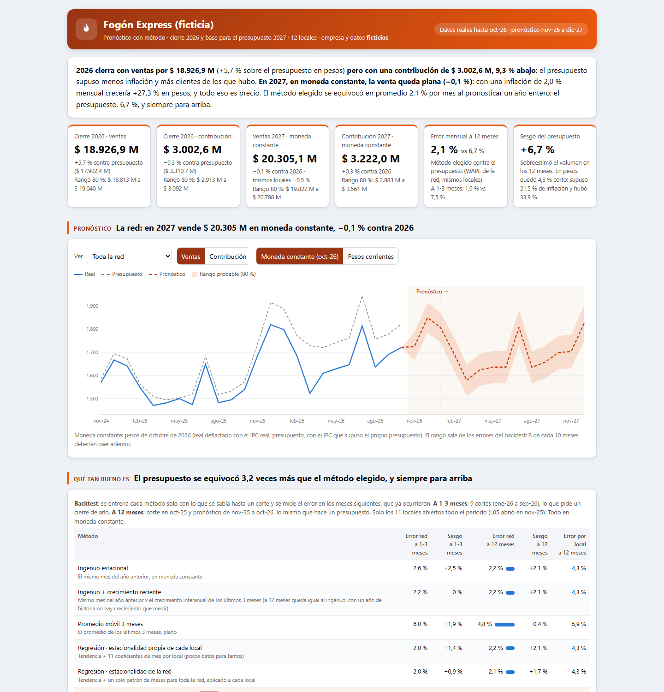
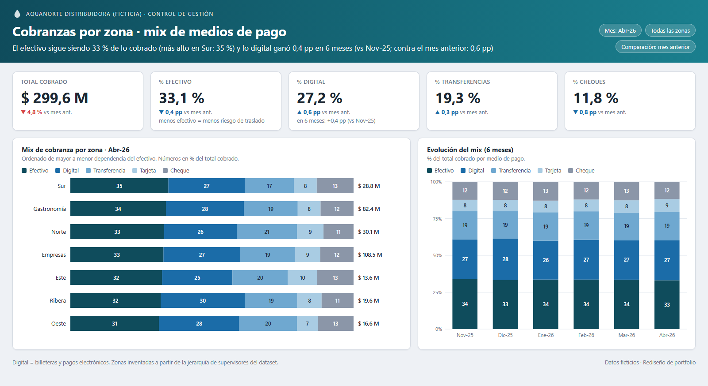

# Management Control Portfolio · Matías Garnica

Accountant (University of Buenos Aires) and management control analyst. I work where numbers meet the business: **where each figure comes from, how it is calculated, and how to tell it to each manager so they can decide.**

Everything here runs on **synthetic data** generated by scripts included in the repository, and can be reproduced end to end. Case documentation is in Spanish.

> 🇦🇷 [Leer en castellano](README.es.md)

---

## Case studies

### Collections agency (BPO) · will we hit the year, and which portfolio makes money?



Full management control for a collections agency with 12 client portfolios:
- **Revenue variance bridge:** separates what management controls (recovery rate, fee) from what it does not (debt inflation, FX, volume assigned by the client).
- **Margin by portfolio** after allocating shared costs by driver (seats, minutes, messages, payments): a portfolio can bill a lot and still lose money.
- **Year-end landing** with a simulator (inflation, wage deals, FX, recovery, volume) and **next year's budget** month by month, exported to an Excel file with live formulas.
- **Pricing tool:** break-even fee and recovery rate for a new portfolio.
- **Power BI version** as a text project (PBIP): star schema and 189 documented DAX measures.

▶ [Dashboard](https://matiasgarnica.github.io/portfolio-control-de-gestion/casos/01_bpo-cobranzas/03_tableros/control_gestion_bpo.html) · [Power BI](casos/01_bpo-cobranzas/05_powerbi/) · [Case docs (Spanish)](casos/01_bpo-cobranzas/)

### 12-store restaurant chain · from network variance to root cause in three clicks



Leadership sees the contribution variance against budget and the store ranking, and with one click each store's variance bridge and its cause (payroll, operations, incidents). It includes:
- **Nominal or constant currency:** sales beat budget in pesos but miss it in constant currency. That is the inflation trap.
- **Peer comparison** ("same stores"), with a **materiality threshold** so not everything turns red.
- **Role-based login demo:** each test user sees only their own data. The database filters it (Supabase row-level security), not the page.
- **Owners explain their variance:** cause, controllable or not, action and deadline, next to the number.
- **Cost proposal** by company size: tools, cost and who does what.

▶ [Dashboard](https://matiasgarnica.github.io/portfolio-control-de-gestion/casos/05_cadena-multisucursal/03_tableros/tablero_direccion.html) · ▶ [Login demo](https://matiasgarnica.github.io/portfolio-control-de-gestion/casos/05_cadena-multisucursal/03_tableros/demo_login.html) · [Case docs](casos/05_cadena-multisucursal/)

### Forecasting with method · how good is the forecast?



Year-end 2026 landing and the baseline for the 2027 budget of the same chain. Before choosing a method, it tests it against the past:
- **Backtest:** the chosen method misses by 2.1 % per month when forecasting a full year. The budget missed by 6.7 %, always on the high side.
- **Price vs volume:** in constant currency, 2027 is flat. All growth in pesos is inflation, shown under three scenarios.
- **Noise or signal:** control bands per store. With a fixed ±5 % rule almost everything needed explaining; with the bands, the three real problems stand out.

▶ [Dashboard](https://matiasgarnica.github.io/portfolio-control-de-gestion/casos/06_pronostico-con-metodo/03_tableros/pronostico.html) · [Method notes (Spanish)](casos/06_pronostico-con-metodo/07_docs/metodo_y_criterios.md)

### Front-line feedback · is it the market or management?

A one-minute form for delivery drivers and customer service, with fixed categories, crossed with sales by route. It separates market-driven drops (every route reports "customer economic situation") from route-specific ones (a single route reports "competition"). An Apps Script builds the Monday summary and alert.

▶ [Dashboard](https://matiasgarnica.github.io/portfolio-control-de-gestion/casos/02_voz-de-primera-linea/03_tableros/voz_primera_linea.html) · [Case docs](casos/02_voz-de-primera-linea/)

### Water and soda distributor BI · SQL + Power BI

T-SQL queries that replaced manual reporting and eleven redesigned dashboards on a 21-table synthetic dataset: customers, routes, orders, collections and hot/cold dispenser equipment.



| # | Module | Featured query | Techniques |
|---|---|---|---|
| 01 | [Acquisition](sql/01_acquisition/) | `altas_digital_rto.sql` | `ROW_NUMBER`, 4-block `UNION ALL`, promo classification |
| 02 | [Retention](sql/02_retention/) | `frio_calor_sin_consumo_60.sql` | State machine, `STUFF` + `FOR XML PATH`, prioritization |
| 03 | [Dispenser equipment](sql/03_fc_equipment/) | `consumo_litros_por_cliente_fc.sql` | Temporal validity, derived ratios |
| 04 | [Financial risk](sql/04_financial_risk/) | `deuda_gastro_por_ruta.sql` | Multi-source `UNION ALL`, accounting separation |
| 05 | [Segmentation](sql/05_segmentation/) | `clientes_barrios_cerrados.sql` | Pattern matching, early filtering |
| 06 | [Sales performance](sql/06_sales_performance/) | `venta_mensual_por_comercial.sql` | Dynamic SQL, double `PIVOT`, indexed temp tables |
| 07 | [Collections](sql/07_collections/) | `cobranzas_mensuales_por_ruta.sql` | `OUTER APPLY`, `REVERSE` + `PATINDEX` parsing |
| 08 | [Daily operations](sql/08_daily_operations/) | `feriados_venta_a_recuperar.sql` | Weekday alignment, consolidated KPI |

The dashboards are **redesigns on synthetic data** (generated with Python from the synthetic dataset), with a color theme to rebuild them in Power BI. Details in [`powerbi/`](powerbi/).

---

## How I work

1. **Question first:** what does the person looking at the dashboard decide?
2. **Where the data comes from:** every metric has its formula, source and variants documented, as in the [Case 05 data dictionary](casos/05_cadena-multisucursal/07_docs/diccionario_datos_e_indicadores.md).
3. **One number per decision,** with what it is compared against (budget, prior year or peers) and who owns it.
4. **Security by design:** who sees what, and within which limits.

## Reproduce

```bash
git clone https://github.com/MatiasGarnica/portfolio-control-de-gestion.git
cd portfolio-control-de-gestion
pip install pandas numpy faker
python casos/05_cadena-multisucursal/02_codigo/generar_datos.py      # Case 05 data
python casos/05_cadena-multisucursal/02_codigo/validar_datos.py      # integrity checks
python data/generate_synthetic_data.py                               # distributor dataset
```

## How it was built

- **My part:** the business question each case answers, the choice of rules (materiality threshold, constant currency, peer comparison) and the review of every number.
- **Built with AI:** the code (Python, JavaScript, Apps Script), the dashboards and the Power BI project were written with AI from those rules. Each case ships a checks script (`validar_datos.py`) that verifies the numbers tie out.
- **Data:** all synthetic, with planted situations so the analysis has something to find. No figure comes from a real company.

## Contact

**Matías Garnica** · [LinkedIn](https://www.linkedin.com/in/garnicamatias) · garnicamatias@outlook.es

[MIT](LICENSE) license.
