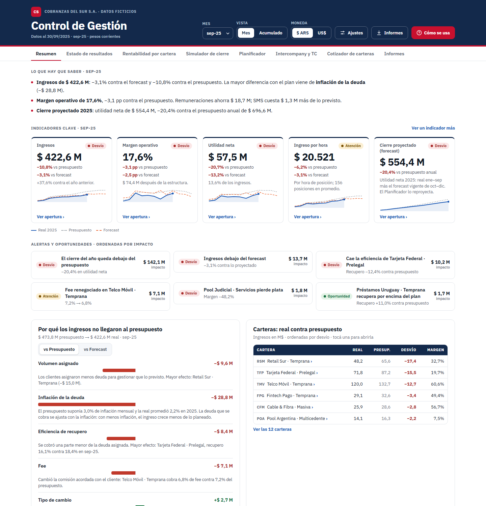

# Caso 01 · Control de gestión de un BPO de cobranzas

Tablero de control de gestión de una empresa ficticia de cobranzas (**Cobranzas del Sur S.A.**, 12 carteras de clientes): real, presupuesto y forecast, rentabilidad por cartera, intercompany, cotizador y planificador del año siguiente. Es un modelo de gestión típico de un BPO de cobranzas, con datos 100% ficticios.



▶ [Abrir el tablero](https://matiasgarnica.github.io/portfolio-control-de-gestion/casos/01_bpo-cobranzas/03_tableros/control_gestion_bpo.html)

## Qué pregunta responde

- **¿Cerramos el año?** Cierre proyectado 2025: utilidad neta de $ 554 M contra $ 697 M presupuestados (−20%).
- **¿Por qué no llegamos al presupuesto?** El ingreso de septiembre quedó $ 51 M abajo. La mayor parte (−$ 29 M) no es de gestión: el presupuesto suponía 3,0% de inflación mensual y la real fue 2,2%.
- **¿Qué cartera gana y cuál pierde plata?** Margen por cartera después de asignar los costos compartidos. Tres carteras explican el 61% del margen; una pierde $ 1,8 M por mes.
- **¿Cuánto cotizar una cartera nueva?** Fee y recupero de equilibrio, escenarios y una propuesta para el cliente.
- **¿Cuánto pesa el tipo de cambio?** Carteras que facturan en dólares, costos en dólares y diferencia de cambio sobre la cuenta corriente intercompany.

## Qué muestra

| Pestaña | Para qué sirve |
|---|---|
| Resumen | Cinco indicadores con su estado, alertas ordenadas por impacto en pesos y el puente que explica el desvío de ingresos |
| Estado de resultados | Real contra forecast, presupuesto y año anterior, en tres niveles (rubro, cuenta, ítem), y el paso de contable a gestión |
| Rentabilidad por cartera | Margen de contribución por cartera, productividad (ingreso y costo por posición) y cómo se reparten los costos compartidos |
| Simulador de cierre | Qué pasa con la utilidad del año si cambian inflación, paritaria, dólar, recupero o volumen de octubre a diciembre |
| Planificador | Cierre 2025 y presupuesto 2026 mes a mes; se descarga a un [Excel con fórmulas vivas](planificador/Planificador-2025-2026.xlsx) |
| Intercompany y TC | Cuánto gasto corporativo absorbe cada país según el criterio de distribución, y la diferencia de cambio |
| Cotizador de carteras | Resultado mensual de una cartera nueva, mapa de fee contra recupero y texto de propuesta |
| Informes | Informes descargables por audiencia (ejemplos en `04_informes/`) |

La captura es la pestaña Resumen con septiembre 2025 en pesos.

## Decisiones de diseño y criterio

| Decisión | Por qué |
|---|---|
| **Puente del desvío de ingresos** en cinco efectos: volumen asignado, inflación de la deuda, eficiencia de recupero, fee y tipo de cambio | Separa lo que depende de la gestión (recupero, fee) de lo que no (inflación, dólar, deuda que asigna el cliente). Explica el desvío antes de juzgarlo. |
| **Costos compartidos asignados por driver**: supervisión por posiciones, telefonía por minutos, SMS y mails por envíos, bocas por pagos | Una cartera puede facturar mucho y perder plata. Sin asignación, todas parecen rentables. |
| **Cierre proyectado = real de los meses cerrados + forecast de los que faltan** | Es la mejor estimación del año a la fecha. Se compara contra el presupuesto anual, no contra el mes. |
| **Moneda**: todo se ve en pesos o en dólares con un botón | Las carteras en dólares y los costos en dólares se mueven con el tipo de cambio; en pesos con inflación alta, comparar en una sola moneda engaña. |
| **Intercompany eliminado** del resultado de gestión | Los honorarios entre empresas del grupo no son ingreso real. Lo que queda es el gasto corporativo que absorbe cada país y la diferencia de cambio del saldo. |
| **Dotación con montos ocultos por rol** | Los sueldos solo los ven RRHH, gerencia y control de gestión. El planificador muestra posiciones y oculta montos hasta activarlos; los informes son distintos por audiencia. |
| **Alertas ordenadas por impacto en pesos** | Lo primero que se lee es lo que más mueve el resultado, no lo que más se desvía en porcentaje. |

## Cómo se calcula

- **Ingreso de una cartera** = deuda asignada × % de recupero × fee × tipo de cambio (1 para las carteras en pesos).
- **Margen de contribución** = ingreso − costos directos (operadores, posiciones externas, ingresos brutos) − costos compartidos asignados por driver.
- **Margen operativo** = margen bruto − gastos de estructura.
- **Ingreso por hora** = ingreso ÷ horas de posición del mes.
- **Diferencia de cambio** = saldo a cobrar en dólares × variación del tipo de cambio del mes.
- **Presupuesto 2026** = ritmo real de julio a septiembre 2025 a precios de septiembre; cada línea se mueve con su índice (precios, salarios, dólar, SMS, posiciones, volumen). Tablero y Excel usan la misma lógica: se verificaron 240 celdas del estado de resultados, diferencia 0.

El detalle de cuentas y el mapeo de planillas Excel a prácticas FP&A está en [07_docs/criterios-y-mapeo.md](07_docs/criterios-y-mapeo.md).

## Limitaciones honestas

- **Los datos son ficticios.** Los genera un script con semilla fija. Las historias (inflación menor a la presupuestada, una cartera que pierde plata, un fee renegociado) están puestas a propósito para que haya algo que explicar.
- **El forecast es simulado.** Representa la proyección que arma cada supervisor; no sale de un modelo estadístico. Con datos reales mediría su precisión mes a mes y por supervisor.
- **Los drivers de asignación son fijos.** Con datos reales los validaría con operaciones (por ejemplo, minutos reales por cartera del discador) y revisaría los que generan discusión.
- **No hay conexión a una base.** El tablero lee un JSON que se arma con Python. En una empresa, una tarea programada correría la consulta SQL, regeneraría ese JSON y volvería a armar la página.
- **Los roles no son seguridad real.** Ocultar montos en la página es una convención de uso; con datos reales los sueldos se filtrarían en la base, antes de llegar al navegador.

## Reproducir

Requiere Python 3.10+ con `pandas`, `numpy` y `openpyxl`. Desde `02_codigo/`:

```
python generate_case.py          # 01_datos/: CSV del modelo estrella + dashboard_data.json
python build_plan.py             # plantilla del planificador y planificador/Planificador-2025-2026.xlsx
python build.py                  # 03_tableros/control_gestion_bpo.html
python ../05_powerbi/build_pbip.py v3   # proyecto Power BI (PBIP) en 05_powerbi/CobranzasDelSur_v3
```

En Windows, si aparece un error de codificación, correr antes `set PYTHONUTF8=1`.

| Carpeta | Qué hay |
|---|---|
| `01_datos/` | Modelo estrella en CSV (carteras, cuentas, fechas, resultado, drivers, KPI, intercompany, conciliación) y `dashboard_data.json` |
| `02_codigo/` | Generador de datos, plantilla y lógica del tablero (`dashboard_template.html`, `app.js`), armado del tablero y del planificador |
| `03_tableros/` | `control_gestion_bpo.html` (abre en el navegador; los gráficos se cargan de jsDelivr, necesita internet) |
| `04_informes/` | Informes de ejemplo descargados desde el tablero: [gerencia de un vistazo](04_informes/informe_gerencia_vistazo.html), [reunión de gestión](04_informes/informe_reunion_gestion.html), [supervisor de una cartera](04_informes/informe_supervisor_una_cartera.html) y [supervisores, todas las carteras](04_informes/informe_supervisores_todas.html) |
| `05_powerbi/` | Versión Power BI: proyecto PBIP (modelo en TMDL, informe en PBIR), 189 medidas DAX documentadas en `MEDIDAS.md` y el generador |
| `planificador/` | Planificador 2025–2026 en Excel con fórmulas |
| `07_docs/` | Criterios y mapeo de planillas Excel a FP&A |
