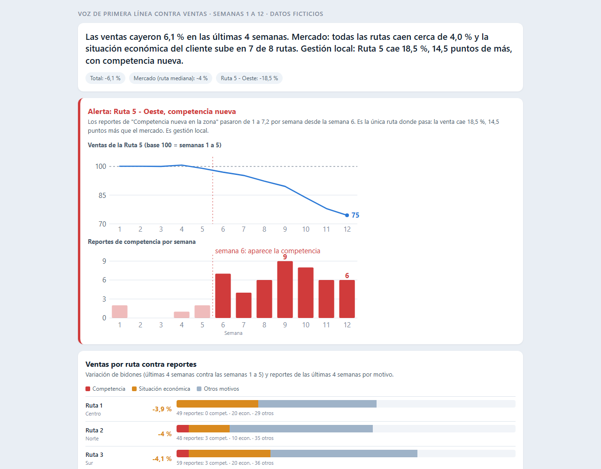

# Caso 02: Voz de primera línea

**Captura de datos sin base: Forms + Sheets + Apps Script.**
Cómo saber *por qué* cambian las ventas, con un formulario de 1 minuto y una planilla.

> Todos los datos son **ficticios**, generados con semilla fija. No hay nombres de empresas, clientes ni personas reales.
> Contexto del caso: distribuidora de agua en bidones, 8 rutas de reparto.



▶ [Abrir el tablero](https://matiasgarnica.github.io/portfolio-control-de-gestion/casos/02_voz-de-primera-linea/03_tableros/voz_primera_linea.html)

## El problema

Los sistemas dicen **qué** pasó: las ventas de la ruta 5 cayeron 18 %. No dicen **por qué**.

Cuando cae una venta, la explicación suele ser una opinión en una reunión. Y hay dos causas muy distintas:

- **Cae el mercado:** la gente tiene menos plata, hace calor o frío, suben los precios en general.
- **Cae la gestión:** llegó un competidor, falló una entrega, un repartidor no pasó.

Las dos se ven igual en el número. Se arreglan distinto.

Quien lo sabe es la primera línea: repartidores, atención al cliente y encargados. Lo escuchan todos los días, pero se queda en un grupo de WhatsApp.

## Para qué sirve

Convierte lo que ve la primera línea en **un dato que se puede contar**.

1. **Explica el desvío.** Al lado de la caída de ventas, se ve qué motivos se reportaron en esa ruta.
2. **Separa mercado de gestión.** Si todas las rutas reportan "situación económica", es mercado. Si una sola reporta "competencia nueva", es gestión local.
3. **Avisa antes.** Los reportes se mueven antes que las ventas. En el caso, "situación económica" sube en la semana 9 y las ventas caen en la semana 10.

## Qué hay en la carpeta

| Carpeta | Qué hay |
|---|---|
| `01_datos/` | `respuestas.csv` (reportes, mismo formato que exporta Forms) y `ventas_semanales.csv` |
| `02_codigo/` | `apps_script_resumen.gs` (va en la planilla), `generar_datos.py`, `analizar.py`, `armar_tablero.py` |
| `03_tableros/` | `voz_primera_linea.html`: tablero autocontenido, se ve bien en el celular |
| `04_informes/` | `hallazgos.md`: separa efecto mercado de efecto local |

## Cómo armarlo en 30 minutos (Google Forms + Sheets)

Necesitás una cuenta de Google. Todo es gratis.

### Paso 1. El formulario (10 minutos)

Entrá a [forms.google.com](https://forms.google.com) y creá un formulario en blanco. Título: **Reporte de primera línea**.
Descripción: *"Un minuto, al terminar el recorrido o el turno. Elegí lo que más escuchaste hoy."*

Cargá **estas cuatro preguntas**, todas de tipo "Opción múltiple" y obligatorias, salvo la última:

**1. ¿Cuál es tu rol?**
- Repartidor
- Atención al cliente
- Encargado

**2. ¿De qué ruta o zona es el reporte?**
- Ruta 1 - Centro
- Ruta 2 - Norte
- Ruta 3 - Sur
- Ruta 4 - Este
- Ruta 5 - Oeste
- Ruta 6 - Costanera
- Ruta 7 - Barrio Parque
- Ruta 8 - Zona Industrial

*(Poné tus rutas o zonas reales, con nombres cortos y siempre iguales.)*

**3. ¿Qué motivo escuchaste o viste más hoy detrás de las ventas?** (elegí uno)
- Precio (contra la competencia)
- Calidad del producto
- Atención o servicio
- Falta de stock o entrega fallida
- Situación económica del cliente
- Clima o estacionalidad
- Competencia nueva en la zona
- Otro (con detalle abajo)

**4. Detalle (opcional).** Tipo "Respuesta corta". Texto de ayuda: *"Una frase, si querés. Sin nombres ni datos de clientes."*

Ajustes importantes (en "Configuración"):
- **Recopilar direcciones de correo: desactivado.** Es un reporte, no una evaluación a nadie.
- **Limitar a 1 respuesta: desactivado.** Cada persona reporta todos los días.
- **Mostrar el enlace para enviar otra respuesta: activado.** Para cargar más de un motivo.

Las categorías son fijas a propósito: "los precios son muy altos" escrito libre no se puede sumar; la categoría **Precio** sí.

### Paso 2. La planilla (3 minutos)

En el formulario: pestaña **Respuestas** > icono de Sheets > **Crear hoja de cálculo**. Las respuestas caen solas en la hoja "Respuestas de formulario 1".

Las columnas quedan: `Marca temporal`, `¿Cuál es tu rol?`, `¿De qué ruta o zona es el reporte?`, `¿Qué motivo...?` y `Detalle`.

### Paso 3. Que llegue a la primera línea (5 minutos)

Copiá el link del formulario (botón **Enviar** > icono de link, acortalo). Mandalo al grupo de WhatsApp de reparto y dejalo como acceso directo en el celular de cada uno.
Pedí que se cargue **al final del recorrido**. Tarda menos de 1 minuto.

### Paso 4. El resumen de los lunes (10 minutos)

1. En la planilla: **Extensiones > Apps Script**.
2. Pegá el contenido de `02_codigo/apps_script_resumen.gs` y guardá.
3. Revisá la sección `CONFIGURACION` (nombre de la hoja y texto de las columnas: `ruta`, `motivo`).
4. Ejecutá `resumenSemanal` una vez y aceptá los permisos. Aparece la hoja **Resumen semanal**.
5. Ejecutá `crearDisparadorSemanal` una vez. Desde ahí se actualiza solo cada lunes a las 7.

La hoja trae tres cosas:
- **Avisos:** motivos que suben al menos al doble contra el promedio de las 4 semanas anteriores, con un mínimo de 4 reportes (se cambia en `CONFIG`).
- **Tabla ruta por motivo** de la semana pasada.
- **Ranking de motivos.**

### Paso 5. Devolverle algo a quien carga (siempre)

Compartí la hoja "Resumen semanal" (solo lectura) con encargados y supervisores, o pegá el ranking en el grupo cada lunes. Si la primera línea no ve que se usa, **deja de cargarlo** en un mes.

## Cómo se usa en el análisis

La planilla de reportes se cruza con las ventas por ruta y semana. Dos preguntas:

| Pregunta | Qué se mira | Lectura |
|---|---|---|
| ¿Es el mercado? | Un motivo sube en **casi todas** las rutas y las ventas bajan en todas | Efecto mercado: no se arregla desde una ruta |
| ¿Es la gestión? | Un motivo sube en **una sola** ruta y esa ruta cae más que las demás | Efecto local: se sale a ver qué pasó |

En este caso (datos ficticios, últimas 4 semanas contra las semanas 1 a 5):
- **Mercado:** "Situación económica del cliente" sube en 7 de 8 rutas. Las ventas caen cerca de 4 % en todas.
- **Local:** en la Ruta 5 - Oeste, "Competencia nueva en la zona" pasa de 1 a 7 reportes por semana desde la semana 6. La ruta cae 18,5 %: 14,5 puntos más que el mercado.

Todo el detalle está en [`04_informes/hallazgos.md`](04_informes/hallazgos.md).

## Cómo reproducir los datos y el tablero

```
cd 02_codigo
python generar_datos.py     # 01_datos/respuestas.csv y ventas_semanales.csv
python analizar.py          # 04_informes/hallazgos.md
python armar_tablero.py     # 03_tableros/voz_primera_linea.html
```

Requiere Python 3 con `pandas` y `numpy`. Semilla fija: siempre da los mismos datos.

## Limitaciones

- **Es una señal, no una encuesta.** Los que cargan no son una muestra al azar. Sirve para ver cambios y comparar rutas, no para medir porcentajes exactos.
- **Pocos reportes por ruta:** con 5 a 10 por semana, un salto chico puede ser azar. Por eso los avisos piden un mínimo de reportes.
- **Sesgo de quien reporta:** el repartidor ve lo que pasa en la calle, no lo que opina el cliente que se fue. El que ya no compra no está en el formulario.
- **Un solo motivo por reporte.** Simple a propósito. Si hay dos, se carga dos veces.
- **Depende de la constancia.** Si un día nadie carga, parece que "no pasó nada". Conviene mirar también cuántos reportes hubo.
- **Correlación no es causa.** Los reportes dan la hipótesis; la confirman la visita a la ruta y los datos de clientes.
- **Formulario abierto:** cualquiera con el link puede cargar. Para uso interno alcanza. Si hace falta saber quién carga, se restringe a la organización (cuentas de Workspace).
- **Datos personales:** el campo libre puede traer nombres de clientes. Se pide no ponerlos y se limita quién ve la planilla.
- **Apps Script tiene cuotas** y depende de una cuenta personal: si esa persona se va, el disparador se va con ella.
- **El Apps Script se revisó, pero todavía no corrió sobre una planilla real de Google.** El análisis y el tablero sí se reprodujeron con `analizar.py`.
- **La planilla se carga a mano en el cruce.** Las ventas hay que pegarlas aparte (o con `analizar.py`); no se conectan solas.

## Qué se le pide a Sistemas en una empresa más grande

La versión de 30 minutos prueba que la idea sirve. Para sostenerla en escala, se le pide a Sistemas:

1. **Que el reporte viva en la app de reparto o en el sistema comercial,** con la ruta y el cliente ya cargados. Un toque, no un formulario.
2. **Una tabla propia en la base de datos** (`reporte_primera_linea`): fecha, ruta, rol, motivo, detalle. Con las mismas categorías fijas en una tabla de códigos.
3. **Un identificador de ruta único** que sea el mismo en ventas y en reportes. Es lo que permite cruzar sin trabajo manual.
4. **Acceso de lectura a las ventas por ruta y semana** (o una vista), para que el cruce sea automático.
5. **Usuarios y permisos por rol:** cada supervisor ve su zona; Dirección ve todo agregado. Mismo criterio que la seguridad por usuario del Caso 05.
6. **Cuenta de servicio** para los procesos automáticos, en lugar de una cuenta personal.
7. **Ubicación y política de datos:** dónde se guarda, cuánto tiempo, y qué pasa con los datos personales del campo libre.
8. **Si el volumen crece** (call center, redes, encuestas de clientes): clasificar el texto libre con IA por tema y sentimiento, sobre la misma tabla.
