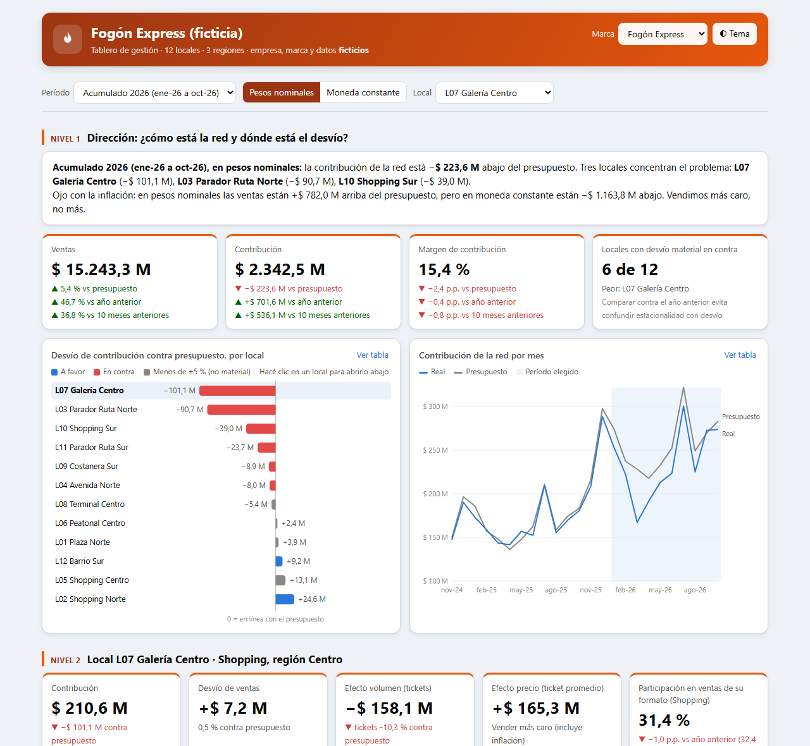

# Caso 05 · Control de gestión de una cadena con 12 locales

Una cadena de comida rápida ficticia (**Fogón Express**; el selector de marca cambia el logo y los colores) con 12 locales en 3 regiones y 3 formatos: calle, shopping y ruta. Período: nov-2024 a oct-2026.



▶ [Abrir el tablero](https://matiasgarnica.github.io/portfolio-control-de-gestion/casos/05_cadena-multisucursal/03_tableros/tablero_direccion.html) · ▶ [Demo con login por rol](https://matiasgarnica.github.io/portfolio-control-de-gestion/casos/05_cadena-multisucursal/03_tableros/demo_login.html)

## Qué pregunta responde

- **Dirección:** ¿cuánto nos desviamos del presupuesto y dónde está el desvío?
- **Gerente de local:** ¿qué rubro explica mi desvío: ventas, mercadería, personal u ocupación?
- **Control de gestión:** ¿es un problema del local o de toda la red? ¿El responsable lo explicó? ¿Cumplió lo que prometió?

## Lo que encuentra

La red está **224 M abajo del presupuesto** en contribución (ene–oct 2026). Tres locales con tres causas concretas explican todo el desvío: rotación de personal en L07, una obra vial en L03 y una rotura de la cámara de frío en L10. Los otros nueve, juntos, están en línea.

Además, el presupuesto subestimó la inflación: **en pesos se vendió más que lo presupuestado; en moneda constante, menos.** Se vendió más caro, no más.

## Decisiones de criterio

| Decisión | Por qué |
|---|---|
| **Tres comparaciones** en cada indicador: presupuesto, año anterior y período anterior | Contra el presupuesto se mide la gestión; contra el año anterior se descuenta la estacionalidad. |
| **Moneda constante** opcional: el real se ajusta con el IPC real y el presupuesto con el IPC que se supuso al armarlo | Separa "vendimos más caro" de "vendimos más". |
| **Umbral de materialidad del 5 %** del presupuesto de cada local | No todo desvío merece una reunión: lo menor queda en gris. |
| **Puente del desvío** por rubro, y ventas abiertas en efecto volumen (tickets) y efecto precio (ticket promedio) | Dice cuánto aporta cada causa al desvío, en pesos. |
| **Comparación contra pares:** el local contra el resto de su formato, y participación con "mismos locales" | Un local de ruta no se compara con uno de shopping. Un local nuevo no infla el crecimiento. |
| **Explicación del responsable con seguimiento:** causa, si era controlable, acción y plazo. Después del plazo, el tablero chequea solo si el desvío volvió debajo del umbral | El número viene con su explicación y con el compromiso de quien lo explica. En el ejemplo, L07 prometió bajar las horas extra para mayo y el desvío sigue (vencido). L10 lo resolvió (cumplido). |
| **Seguridad en la base, no en la página** (demo con login) | Cada usuario de prueba ve solo su local o región. Lo filtra Supabase con seguridad por fila. |

## Qué hay en la carpeta

| Carpeta | Qué hay |
|---|---|
| `02_codigo/` | `generar_datos.py` (semilla fija), `validar_datos.py` (controles de integridad y de las historias), `armar_tablero.py` + `tablero_plantilla.html`, `armar_demo.py` y `supabase_esquema.sql` (tablas, seguridad por fila y funciones) |
| `03_tableros/` | `tablero_direccion.html` (autocontenido) y `demo_login.html` (sin datos adentro: los pide a la base según el usuario) |
| `07_docs/` | [Diccionario de datos e indicadores](07_docs/diccionario_datos_e_indicadores.md) · [Guía de hallazgos](07_docs/guia_hallazgos.md) · [Seguridad de la demo](07_docs/seguridad_demo.md) · [Propuesta económica según el tamaño de la empresa](07_docs/propuesta_economica.md) |

## Reproducir

```bash
cd casos/05_cadena-multisucursal/02_codigo
pip install pandas numpy
python generar_datos.py      # crea 01_datos/ con los CSV
python validar_datos.py      # controles: tiene que terminar en "TODO OK"
python armar_tablero.py      # arma 03_tableros/tablero_direccion.html
```

## Limitaciones

- Los datos son inventados y las situaciones están plantadas a propósito: el caso muestra el método, no hallazgos reales.
- El tablero autocontenido lleva todos los datos adentro. Sirve para un portfolio; en una empresa, el filtro por usuario va en la base, como en la demo.
- Falta la versión para una empresa mediana en Power BI. La propuesta económica dice qué cambiaría.
