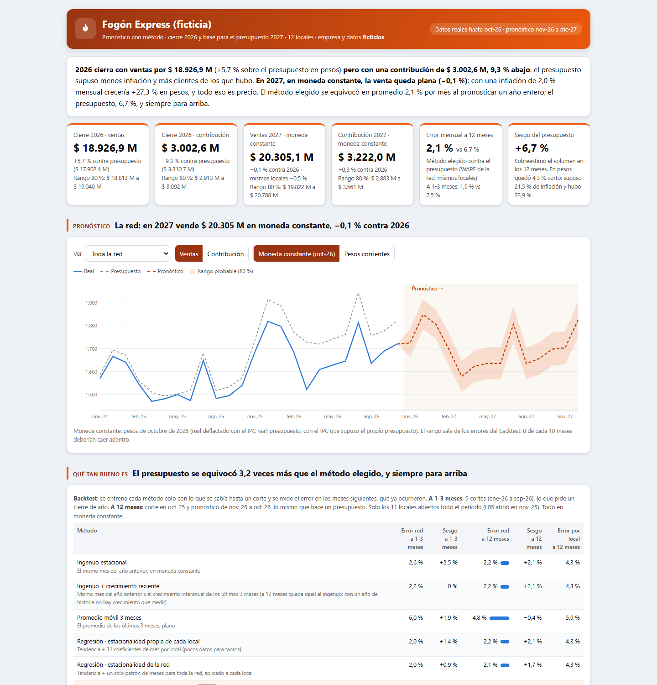

# Caso 06 · Pronóstico con método

**¿Cuánto vamos a vender y ganar, con qué método, y qué tan bueno es ese método?**
Cierre 2026 y base para el presupuesto 2027 de una cadena de 12 locales de comida (Fogón Express, **empresa y datos ficticios**, los mismos del [Caso 05](../05_cadena-multisucursal/)).

**[Ver el tablero](https://matiasgarnica.github.io/portfolio-control-de-gestion/casos/06_pronostico-con-metodo/03_tableros/pronostico.html)** · HTML autocontenido, se abre también con doble clic.



## La respuesta en tres líneas

- **2026 cierra con ventas por $ 18.927 M (+5,7 % sobre el presupuesto en pesos) pero con una contribución 9,3 % abajo**: el presupuesto supuso menos inflación y más clientes de los que hubo.
- **En 2027, en moneda constante, la venta queda plana (−0,1 %).** Con 2 % de inflación mensual crecería 27 % en pesos, y todo eso es precio.
- **El método elegido se equivoca 2,1 % por mes pronosticando un año; el presupuesto, 6,7 %, y siempre para arriba.**

## Qué muestra

| Pregunta de un gerente de finanzas | Dónde está |
|---|---|
| ¿Con qué método proyectás y por qué ese? | **Backtest**: 6 métodos y el presupuesto, entrenados solo con lo que se sabía en cada corte (a 1-3 meses con 9 cortes, y a 12 meses) |
| ¿Qué tan bueno es tu forecast? | Error (WAPE) y **sesgo** de cada método, en la red y por local |
| ¿Cuánto vamos a vender y ganar? | Pronóstico por local y red, con **rango probable del 80 %**, en moneda constante o en pesos |
| ¿Cuánto del crecimiento es inflación? | **Escenarios de IPC** (bajo, base, alto) y puente volumen / precio |
| ¿Este desvío es ruido o señal? | **Bandas de control** por local: 5 locales con señal, y los 3 problemas reales del Caso 05 (obra en L03, personal en L07, rotura en L10) aparecen |

## Decisiones de criterio

- **Moneda constante primero, inflación después.** El modelo aprende volumen; la inflación es un supuesto explícito que se cambia sin rehacer nada.
- **El presupuesto compite como un método más.** Pierde por lejos: error 3 veces mayor, todo sesgo.
- **Con 24 meses, la estacionalidad se estima por tipo de local** (urbano y ruta), no local por local: cada mes se vio solo dos veces, y el backtest muestra que estimar 11 coeficientes por local empeora.
- **Regresión robusta**: los meses con un residuo extremo (la obra de L03) no entrenan el modelo, con una regla automática.
- **Las bandas usan la mediana de los locales y un desvío robusto**, para que un local que se cae no haga parecer buenos a los demás ni ensanche la banda.
- **El elegido empata con un método simple a nivel red.** Se dice; gana por local y sirve para el local nuevo.

Detalle, definiciones y **12 preguntas que te pueden hacer en una entrevista con su respuesta**: [`07_docs/metodo_y_criterios.md`](07_docs/metodo_y_criterios.md).

## Limitaciones

24 meses de historia; backtest de un solo año (2026, con tres problemas operativos); los meses 13 y 14 del pronóstico no tienen respaldo en el backtest; el rango supone que el error futuro se parece al pasado; el presupuesto de nov-dic 2026 no está en los datos y se completó con sus propios supuestos. Datos ficticios: el punto es el método.

## Reproducir

Requiere Python 3.10+ con pandas y numpy. Desde la raíz del repositorio:

```
python casos/05_cadena-multisucursal/02_codigo/generar_datos.py      # genera los CSV (no se suben al repo)
python casos/06_pronostico-con-metodo/02_codigo/pronosticar.py       # backtest, pronóstico, bandas -> 02_codigo/salida/
python casos/06_pronostico-con-metodo/02_codigo/armar_tablero.py     # arma 03_tableros/pronostico.html
```

Si los CSV están en otra carpeta: `pronosticar.py --datos RUTA`. Sin aleatoriedad: siempre da lo mismo.

| Carpeta | Qué hay |
|---|---|
| `02_codigo/` | `pronosticar.py` (métodos, backtest, intervalos, escenarios, bandas), `armar_tablero.py` y `tablero_plantilla.html` |
| `03_tableros/` | `pronostico.html` (gráficos SVG propios, sin librerías externas) y la captura |
| `07_docs/` | `metodo_y_criterios.md` |
