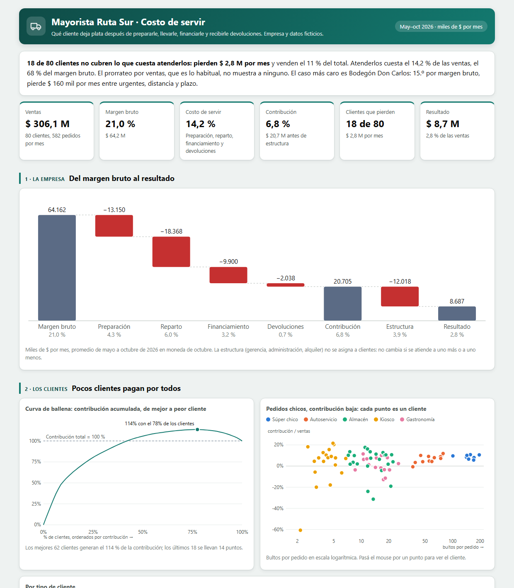

# Caso 07 · Costo de servir por cliente

**¿Qué cliente deja plata de verdad, después de lo que cuesta atenderlo?**
Un mayorista que reparte a 80 comercios: súper chicos, autoservicios, almacenes, kioscos y gastronomía (Mayorista Ruta Sur, **empresa y datos ficticios**).

**[Ver el tablero](https://matiasgarnica.github.io/portfolio-control-de-gestion/casos/07_costo-de-servir/03_tableros/costo_de_servir.html)** · HTML autocontenido, se abre también con doble clic.



## La respuesta en tres líneas

- **18 de 80 clientes no cubren lo que cuesta atenderlos: pierden $ 2,8 M por mes.** Atender a la cartera cuesta el 14,2 % de las ventas, dos tercios del margen bruto.
- **El margen bruto ordena al revés.** El kiosco tiene el mejor margen bruto (29,7 %) y el súper el peor (16,9 %); después de servir, el súper deja 8,7 % y el kiosco 5,6 %. El caso más caro es un bodegón: 15.º por margen bruto, pierde $ 160 mil por mes entre pedidos urgentes, distancia y 45 días de plazo.
- **El prorrateo por ventas, que es lo habitual, no muestra a ninguno de los 18.** Con pedido mínimo de 10 bultos, plazo máximo de 30 días y cargo por urgente, la contribución sube $ 8,0 M por mes y los que pierden pasan de 18 a 7.

## Qué muestra

| Pregunta de un gerente | Dónde está |
|---|---|
| ¿Cuánto se va entre el margen bruto y el resultado? | **Cascada**: preparación, reparto, financiamiento, devoluciones y estructura |
| ¿Cuántos clientes pagan por los demás? | **Curva de ballena**: el 78 % de los clientes genera el 114 % de la contribución |
| ¿Por qué pierde un cliente? | **Detalle por cliente**: su cascada y sus drivers contra el promedio de su tipo, con la palanca que corresponde |
| ¿Por qué no lo vimos antes? | **Prorrateo contra costeo por actividad**: los 18 aparecen con ganancia si el costo se reparte por ventas |
| ¿Qué hacemos? | **Simulador de palancas**: pedido mínimo, cargo por urgente y plazo máximo, con las visitas y camiones que se liberan |
| ¿Cambia la conclusión con otro criterio? | **Sensibilidad**: con criterios extremos pierden entre 13 y 26 clientes; al menos 13 de los 18 siguen en la lista |

## Decisiones de criterio

- **Cada costo con su driver, no con las ventas.** Depósito por pedido y por bulto, reparto por visita y por km, financiamiento por saldo y días, devoluciones por monto devuelto.
- **Las tasas salen del estado de resultados.** Costo de la actividad ÷ cantidad del driver. Se pueden rastrear de la cuenta contable a la tasa.
- **La estructura no se asigna.** Gerencia, administración y alquiler no cambian si se atiende a un cliente más o menos: se mira la contribución.
- **El ahorro de las palancas es potencial.** Si salen visitas pero la flota queda igual, no se ahorra nada. Por eso el simulador muestra cuántos camiones se liberan.
- **El cliente que pierde no se echa: se le cambia la forma de atenderlo.** Cada causa tiene su palanca: frecuencia, distancia, urgentes, plazo o devoluciones.

Definiciones, supuestos y preguntas frecuentes: [`07_docs/metodo_y_criterios.md`](07_docs/metodo_y_criterios.md).

## Cómo se aplica en una empresa chica

Con lo que una distribuidora ya tiene (facturas, hoja de ruta y cuenta corriente) y dos semanas de relevamiento: cronometrar unos 50 pedidos en el depósito y medir el desvío de cada cliente en un mapa. Arranca en una planilla; el ranking se actualiza todos los meses y las tasas se revisan cada trimestre.

## Limitaciones

Seis meses de datos. Las tasas son promedio: un pedido de madrugada o un cliente con escalera cuesta más y no se ve. El simulador supone que bajar la frecuencia no cambia lo que compra el cliente, salvo el porcentaje de ventas perdidas que se elija. Datos ficticios: el punto es el método.

## Reproducir

Requiere Python 3.10+, sin librerías externas. Desde la raíz del repositorio:

```
python casos/07_costo-de-servir/02_codigo/generar_datos.py     # genera los CSV en 01_datos (no se suben al repo)
python casos/07_costo-de-servir/02_codigo/costo_servir.py      # tasas, costo por cliente, curva -> 02_codigo/salida/
python casos/07_costo-de-servir/02_codigo/armar_tablero.py     # arma 03_tableros/costo_de_servir.html
```

Semilla fija: siempre da lo mismo.

| Carpeta | Qué hay |
|---|---|
| `02_codigo/` | `generar_datos.py`, `costo_servir.py` (método), `armar_tablero.py` y `tablero_plantilla.html` |
| `03_tableros/` | `costo_de_servir.html` (gráficos SVG propios) y la captura |
| `07_docs/` | `metodo_y_criterios.md` |
